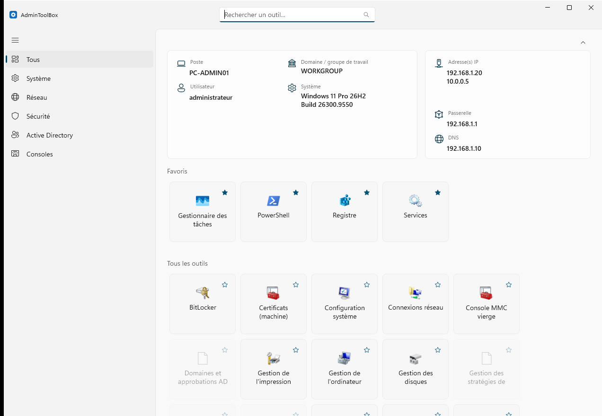
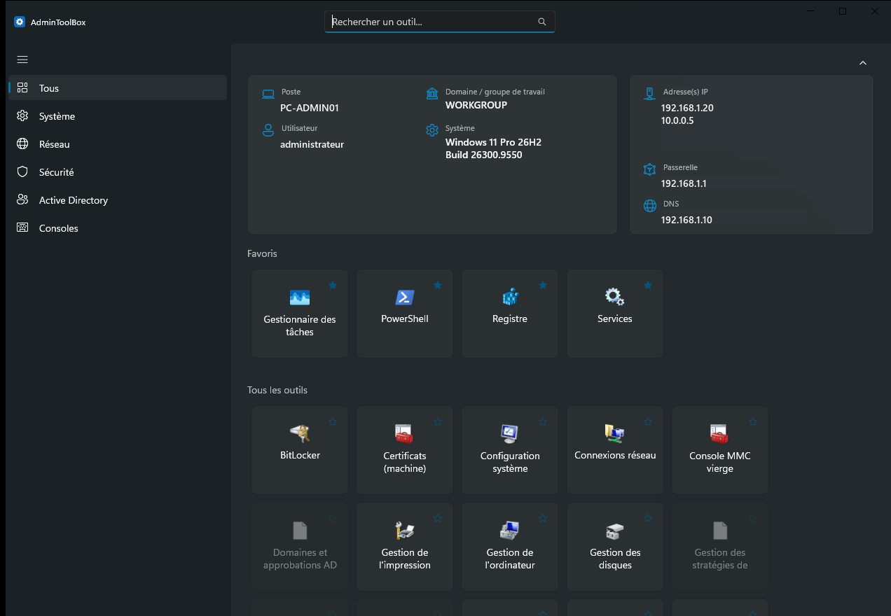
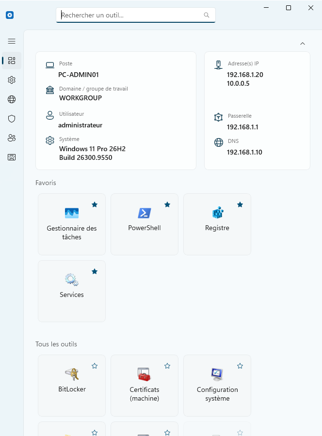
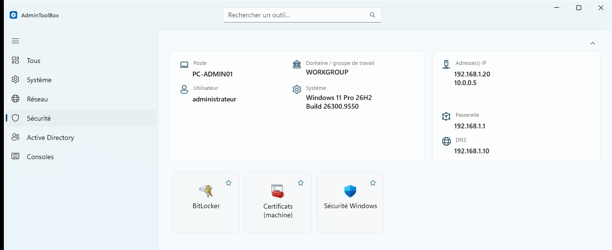
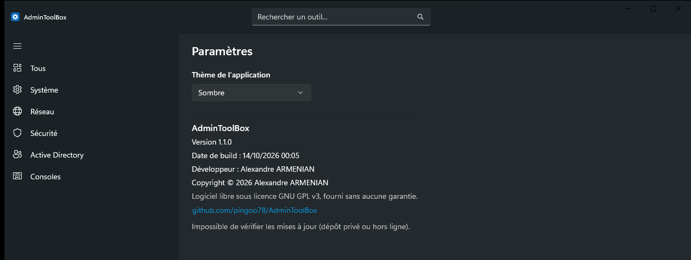

<div align="center">


# 🧰 AdminToolBox

**La boîte à outils d'administration Windows : tous les raccourcis utiles, réunis dans une seule fenêtre.**

Consoles MMC, panneaux de configuration, PowerShell, outils Active Directory, LAPS... plus besoin de retenir le nom d'une commande ni de fouiller dans les menus Windows.


[📥 Télécharger](https://github.com/pingoo78/AdminToolBox/releases/latest) · [✨ Fonctionnalités](#-fonctionnalités) · [🧩 Outils](#-catégories-et-outils) · [🛠️ Compiler](#️-compilation-et-installateur)

</div>

---

## 📸 Aperçu

<div align="center">



*Vue principale (thème clair) : informations du poste, favoris en tête, puis tous les outils. Les outils absents du poste (ici RSAT et LAPS) sont grisés.*



*Le même écran en thème sombre.*

</div>

<table>
<tr>
<td align="center" width="50%">
<br/>
<em>🪟 Mode compact : panneau réduit en icônes, informations empilées</em>
</td>
<td align="center" width="50%">
<br/>
<em>🛡️ Navigation par catégorie</em><br/><br/>
<br/>
<em>⚙️ Paramètres : thème et à propos</em>
</td>
</tr>
</table>

## 🚀 Pourquoi AdminToolBox ?

AdminToolBox est une application de bureau Windows (**WinUI 3 / .NET 8**) qui rassemble dans une interface unique, claire et réactive les outils système que les administrateurs lancent le plus souvent : consoles `.msc`, applets du panneau de configuration, protocoles `ms-settings:`, consoles PowerShell et Terminal...

Elle se lance toujours avec **élévation administrateur** (UAC), affiche un **résumé réseau/système** du poste en un coup d'œil, et s'adapte au redimensionnement de la fenêtre, jusqu'à un mode compact à la manière du Gestionnaire des tâches de Windows 11.

## ✨ Fonctionnalités

| | |
|---|---|
| 🧩 **~40 outils, 5 catégories** | Système, Réseau, Sécurité, Active Directory, Consoles, chacun avec sa véritable icône Windows, extraite dynamiquement. |
| 🔎 **Recherche instantanée** | Intégrée à la barre de titre, filtre par nom et description. |
| 💡 **Infobulles utiles** | Description de l'outil **et commande exacte** lancée, pour savoir ce qui s'exécute. |
| 🚦 **Détection de disponibilité** | Un outil absent (RSAT, LAPS...) est grisé, et un clic indique le prérequis à installer. |
| ⭐ **Favoris** | Une étoile épingle l'outil dans une section dédiée, en tête de « Tous ». |
| 🖥️ **Infos du poste** | Nom du poste, domaine / groupe de travail, utilisateur, adresses IP, passerelle, DNS, version et build de Windows (corrige l'affichage « Windows 10 » sur Windows 11). |
| 🔽 **Panneaux réductibles** | Une flèche réduit les infos du poste ; l'état est mémorisé, même après redémarrage. |
| 📐 **Interface adaptative** | Navigation étendue, compacte ou minimale (menu hamburger dans la barre de titre) selon la largeur de la fenêtre. |
| 🌗 **Thèmes** | Clair, sombre ou système, mémorisé entre les sessions. |
| 🔐 **Sécurité** | Élévation UAC, outils lancés par chemin absolu depuis des dossiers de confiance (jamais le `PATH`). |
| 🔄 **Mises à jour** | Vérification de la dernière version au démarrage, statut visible dans les paramètres. |

## 🧩 Catégories et outils

<details>
<summary>⚙️ <strong>Système</strong> (21 outils)</summary>

| Outil | Description |
|---|---|
| Registre | Éditeur du Registre Windows |
| Observateur d'événements | Journaux d'événements Windows |
| Gestionnaire des tâches | Processus, performances, démarrage |
| Gestionnaire de périphériques | Matériel et pilotes |
| Gestion de l'ordinateur | Console de gestion regroupée |
| Services | Services Windows |
| Stratégie de groupe locale | Éditeur de la stratégie de groupe locale |
| Stratégie de sécurité locale | Comptes, audit, droits utilisateur |
| Utilisateurs et groupes locaux | Comptes locaux de la machine |
| Gestion des disques | Partitions et volumes |
| Planificateur de tâches | Tâches planifiées |
| Moniteur de ressources | CPU, mémoire, disque, réseau en direct |
| Moniteur de performances | Compteurs de performance |
| Configuration système | Options et services au démarrage |
| Informations système | Détails matériel, pilotes, composants |
| Panneau de configuration | Panneau de configuration classique |
| Paramètres Windows | Nouvelle application Paramètres |
| Propriétés système | Nom d'ordinateur, matériel, protection système |
| Variables d'environnement | Édition des variables système/utilisateur |
| Nettoyage de disque | Libère de l'espace disque |
| Gestion de l'impression | Imprimantes, pilotes et files d'attente |

</details>

<details>
<summary>🌐 <strong>Réseau</strong> (5 outils)</summary>

| Outil | Description |
|---|---|
| Connexions réseau | Cartes et connexions réseau |
| Pare-feu Windows Defender | Pare-feu avec fonctions avancées de sécurité |
| Partages et sessions | Dossiers partagés et sessions actives |
| Gestion DNS | Console DNS *(nécessite RSAT)* |
| Gestion DHCP | Console DHCP *(nécessite RSAT)* |

</details>

<details>
<summary>🛡️ <strong>Sécurité</strong> (3 outils)</summary>

| Outil | Description |
|---|---|
| Certificats (machine) | Magasin de certificats de l'ordinateur |
| BitLocker | Chiffrement de lecteur |
| Sécurité Windows | Windows Defender |

</details>

<details>
<summary>👥 <strong>Active Directory</strong> (5 outils, RSAT / LAPS requis)</summary>

| Outil | Description |
|---|---|
| Utilisateurs et ordinateurs AD | Comptes, groupes, unités d'organisation *(RSAT)* |
| Gestion des stratégies de groupe | GPO du domaine *(RSAT)* |
| Sites et services AD | Topologie de réplication *(RSAT)* |
| Domaines et approbations AD | Relations d'approbation entre domaines *(RSAT)* |
| LAPS UI | Mots de passe administrateur local, version legacy *(nécessite LAPS UI, `AdmPwd.UI.exe`)* |

</details>

<details>
<summary>⌨️ <strong>Consoles</strong> (5 outils)</summary>

| Outil | Description |
|---|---|
| PowerShell | Console PowerShell |
| PowerShell ISE | Éditeur de scripts PowerShell |
| Invite de commandes | Invite de commandes classique |
| Windows Terminal | Terminal moderne à onglets *(si installé)* |
| Console MMC vierge | Console de gestion Microsoft vierge |

</details>

## 📥 Installation

1. Téléchargez le fichier `AdminToolBox-x.y.z-win-x64.msi` depuis la page des [**Releases**](https://github.com/pingoo78/AdminToolBox/releases/latest).
2. Lancez-le et suivez l'assistant (installation dans `Program Files`, raccourci dans le menu Démarrer).
3. Démarrez **AdminToolBox** : une invite UAC apparaît, c'est normal.

**Prérequis :** Windows 10 1809 (build 17763) ou supérieur (Windows 11 recommandé), x64. Aucun runtime à installer : l'application est autonome.

## 🛠️ Compilation et installateur

**Prérequis de développement :** [.NET 8 SDK](https://dotnet.microsoft.com/download/dotnet/8.0) et le [Windows App SDK](https://learn.microsoft.com/windows/apps/windows-app-sdk/downloads).

```powershell
git clone https://github.com/pingoo78/AdminToolBox.git
cd AdminToolBox
dotnet build -p:Platform=x64
```

> `-p:Platform=x64` est nécessaire : sans cette précision, le SDK peut mal résoudre la plateforme cible par défaut.

### 📦 Build de distribution (autonome)

```powershell
dotnet publish -c Release -r win-x64 -p:Platform=x64 --self-contained true
```

Génère un exécutable autonome dans `bin\x64\Release\net8.0-windows10.0.19041.0\win-x64\publish\`.

### 💿 Installateur (.msi)

```powershell
dotnet tool install --global wix --version 5.0.2
wix extension add WixToolset.UI.wixext/5.0.2
wix build Installer/AdminToolBox.wxs -arch x64 -ext WixToolset.UI.wixext `
  -d LicenseRtf="Installer\License.rtf" `
  -d PublishDir="bin\x64\Release\net8.0-windows10.0.19041.0\win-x64\publish" `
  -out Installer/AdminToolBox.msi
```

> La version 5.x de WiX est utilisée volontairement : la v7 impose l'acceptation d'un « Open Source Maintenance Fee » (EULA) avant utilisation.

## 🧱 Stack technique

- **WinUI 3** (Windows App SDK) sur **.NET 8**, en C#
- Application **non empaquetée** (pas de MSIX), autonome (self-contained)
- Icônes extraites nativement des exécutables et DLL Windows (`ExtractIconEx` / `SHGetFileInfo`)
- Préférences (thème, favoris, panneaux réduits) en JSON local sous `%LocalAppData%\AdminToolBox`
- Installateur **MSI** généré avec **WiX Toolset v5**

## 📁 Structure du projet

```
AdminToolBox/
├── Controls/     Contrôles XAML personnalisés (WrapPanel adaptatif)
├── Models/       Modèles de données (ToolItem, ToolCategory, InfoItem)
├── Services/     Logique métier (catalogue, lancement, icônes, infos système, paramètres, mises à jour)
├── ViewModels/   Liaison de données pour l'interface
├── Installer/    Source WiX de l'installateur MSI et texte de la licence
├── docs/         Captures d'écran du README
└── MainWindow.*  Fenêtre principale
```

## 📄 Licence

AdminToolBox est distribué sous licence [**GNU GPL v3**](LICENSE) : libre d'utilisation, de modification et de redistribution, à condition que tout dérivé distribué reste lui aussi sous GPL v3. Le logiciel est fourni sans aucune garantie.

## 👤 Auteur

**Alexandre ARMENIAN** · [github.com/pingoo78](https://github.com/pingoo78)
